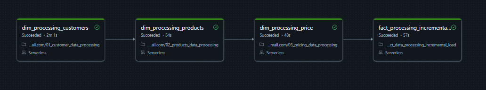
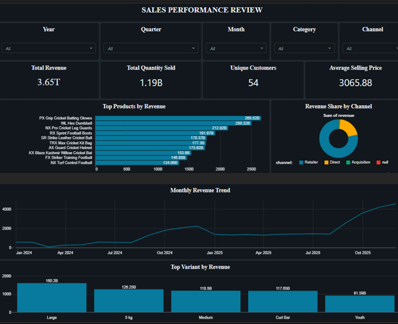

# 🏢 DATABRICKS MERGER AND ACQUISITION DATA PIPELINE

> **Business Scenario:** A parent company has acquired a subsidiary. The subsidiary's historical data was trapped in a legacy OLTP system, causing reporting bottlenecks. This project engineers a modern Databricks Lakehouse to extract, transform, and continuously sync the acquired company's data, while seamlessly integrating it into the parent company's consolidated enterprise reporting layer.


---

## 📖 Table of Contents
1. [The Business Problem](#-the-business-problem)
2. [Engineering Highlights](#-engineering-highlights)
3. [Repository Structure](#-repository-structure)
4. [Data Pipeline Flow & Transformations](#-data-pipeline-flow-transformations)
5. [Orchestration & Workflow](#-orchestration-workflow)
6. [The Executive Dashboard](#-the-executive-dashboard)
7. [Appendix: Core SQL Logic](#-appendix-core-sql-logic)
8. [Conclusion](#-conclusion)

---

## 🏢 The Business Problem
During a corporate acquisition, the parent company needs to report on combined sales performance. However, the acquired company operates on a legacy OLTP database. 

*   **Performance Bottlenecks:** The legacy OLTP system cannot handle heavy analytical reporting without degrading operational performance.
*   **Data Quality:** The legacy system contains poor data quality (missing cities, malformed prices like `"unknown"` or `"-84"`, inconsistent casing, and mixed date formats like `"Tuesday, September 30, 2025"` vs `"2025/09/30"`).
*   **Standardization:** Data must be modeled into a Star Schema to fit the parent company's existing enterprise reporting standards.
*   **Idempotency:** The pipeline must handle both historical full loads and daily incremental updates without duplicating data upon re-runs.

---

## 🚀 Engineering Highlights

*   **Idempotent Processing (S3 Routing):** Engineered safeguards to ensure pipeline re-runs never duplicate data. Files are ingested, and once processed, an automated Python script moves them from the S3 `landing/` to the `processed/` folder.
*   **Advanced UPSERT (MERGE) Logic:** Implemented Delta Lake `MERGE INTO` statements on composite business keys (e.g., matching on `order_id`, `order_placement_date`, `customer_id`, and `product_code`) to seamlessly upsert changed records.
*   **Incremental Aggregation Engine:** Built an incremental pipeline that identifies the distinct affected months from the new batch and recalculates the monthly totals by combining historical data with the new incoming data before merging.
*   **Data Quality Remediation:** 
    *   **Customers:** Handled missing `city` data by engineering a mapping table strategy (`customer_city_map`) to impute missing values based on customer IDs. Standardized whitespace and casing using `trim()` and `initcap()`.
    *   **Products:** Corrected spelling errors (e.g., "Protien" to "Protein") using `regexp_replace`. Dynamically extracted product variants (e.g., "60g") using regex `r'\((.*?)\)'`.
    *   **Pricing:** Cleaned invalid string prices and handled negative values by converting them to absolute doubles, filtering out zero-price anomalies.
    *   **Orders:** Parsed mixed date formats using `try_to_date` with multiple fallback formats. Sanitized invalid IDs using regex `^[0-9]+$`.
*   **Performance Optimization:** Built a pre-joined Denormalized View to ensure sub-second query times.

---

## 📂 Repository Structure

| Component | Type | Description |
| :--- | :--- | :--- |
| **[01_customer_data_processing](https://github.com/ArjunTheAnalyst/DATABRICKS_MERGER_AND_ACQUISITION_DATA_INTEGRATION_PIPELINE/blob/main/01_customer_data_processing.ipynb)** | Notebook (PySpark) | Cleans raw customer data, deduplicates, fixes missing cities using `customer_city_map`, applies `initcap`, and `MERGE`s into the Gold dimension. |
| **[02_products_data_processing](https://github.com/ArjunTheAnalyst/DATABRICKS_MERGER_AND_ACQUISITION_DATA_INTEGRATION_PIPELINE/blob/main/02_products_data_processing.ipynb)** | Notebook (PySpark) | Parses product names, extracts variants, fixes spelling, generates a SHA-256 `product_code` hash, and merges into the Gold dimension. |
| **[03_pricing_data_processing](https://github.com/ArjunTheAnalyst/DATABRICKS_MERGER_AND_ACQUISITION_DATA_INTEGRATION_PIPELINE/blob/main/03_pricing_data_processing.ipynb)** | Notebook (PySpark) | Validates gross pricing data, removes `"unknown"` strings, handles negative values, and finds the latest non-zero price per product per year. |
| **[04_fact_data_processing_full_load](https://github.com/ArjunTheAnalyst/DATABRICKS_MERGER_AND_ACQUISITION_DATA_INTEGRATION_PIPELINE/blob/main/04_fact_data_processing_full_load.ipynb)** | Notebook (PySpark) | The initial historical load. Parses mixed date formats, drops null quantities, and aggregates data to the monthly grain for the Gold Fact table. |
| **[05_fact_data_processing_incremental_load](https://github.com/ArjunTheAnalyst/DATABRICKS_MERGER_AND_ACQUISITION_DATA_INTEGRATION_PIPELINE/blob/main/05_fact_data_processing_incremental_load.ipynb)** | Notebook (PySpark) | The daily sync. Reads from the landing zone, applies transformations, merges to Silver, and re-aggregates affected months before merging to Gold. |
| **[SQL Queries](#-appendix-core-sql-logic)** | Query (SQL) | Includes the `COPY INTO` append logic, the Denormalized View creation, and the Date Dimension generation. |
| **[INSIGHTS DASHBOARD](#-the-executive-dashboard)** | Dashboard | The final executive dashboard for visualizing combined sales performance. |

---

## ⚙️ Data Pipeline Flow & Transformations

### 1. Bronze Ingestion
Raw CSVs are loaded using `spark.read` with `inferSchema=True`. We append metadata columns (`_metadata.file_name`, `_metadata.file_size`) for lineage and a `current_timestamp()` for audit tracking before writing to Delta.

### 2. Silver Transformations (PySpark)
Each dataset undergoes rigorous cleaning in the Silver layer:
*   **Dates:** `coalesce(try_to_date(..., 'yyyy/MM/dd'), try_to_date(..., 'MMMM dd, yyyy'))` ensures heterogeneous date strings are safely cast to `DateType`.
*   **Categorical Data:** Misspelled cities are mapped via a Python dictionary and applied using `df.replace()`. Invalid IDs are nullified or replaced with a fallback (`999999`) using `rlike(r'^[0-9]+$')`.
*   **Hashing:** Product names are hashed into a 64-character `product_code` using `sha2(col('product_name'), 256)` to create a stable, deterministic surrogate key.

### 3. Gold Aggregation & Incremental Updates
For full loads, fact data is aggregated to the monthly grain (`month_start`, `product_code`, `customer_code`).<br>
For **incremental loads**, the pipeline executes a sophisticated flow:
1.  Extracts the distinct `affected_months` from the new batch.
2.  Re-aggregates the entire staging table for those specific months.
3.  Merges the recalculated monthly totals into the final Gold Fact table.

---

## 🗓️ Orchestration & Workflow



The pipeline is fully automated via **Databricks Workflows**.

### Task Dependencies:
To ensure referential integrity, the job processes data in a strict order:
1. **`dim_processing_customers`** (Cleans and merges customer dimension)
2. **`dim_processing_products`** (Cleans and merges product dimension)
3. **`dim_processing_price`** (Cleans and merges gross price dimension)
4. **`fact_processing_incremental_load`** (Runs *last*, aggregating and merging the fact table only after all dimensions are up to date)

All tasks run on **Serverless Compute**, ensuring auto-scaling and cost-efficiency. The entire workflow completes in roughly 5 minutes.

---

## 📈 The Executive Dashboard



Designed a Sales Performance Review Dashboard in Databricks SQL to visualize the unified data. 

*   **Dynamic Filtering:** Users can slice data by Year, Quarter, Month, Category, and Channel.
*   **KPIs:** Total Revenue, Total Units Sold, Unique Customers, and Average Selling Price (ASP).
*   **Visuals:** Top Products by Revenue (Horizontal Bar), Revenue Share by Channel (Donut), Monthly Revenue Trend (Area Chart), and Top Variants (Vertical Bar).

---

## 💻 Appendix: Core SQL Logic

### 1. Appending Incremental Data to Parent Gold
This `COPY INTO` statement reads the processed incremental CSV from the Unity Catalog Volume and appends it to the parent company's consolidated Gold fact table.

```
COPY INTO fmcg.gold.fact_orders
FROM (
SELECT
    CAST(date AS DATE) AS date,
    product_code,
    customer_code,
    CAST(sold_quantity AS BIGINT) AS sold_quantity
FROM
    '/Volumes/fmcg/gold/parent_gold_incremental_update/fact_orders.csv'
)
FILEFORMAT = CSV
FORMAT_OPTIONS ('header' = 'true');
```

### 2. Denormalized View
To optimize the dashboard for sub-second query performance, this view joins the consolidated Fact table with the `Date`, `Product`, `Customer`, and `Gross Price` dimensions.

```
CREATE OR REPLACE VIEW fmcg.gold.flat_table AS
SELECT
    fo.date,
    fo.product_code,
    fo.customer_code,
    fo.sold_quantity,
    dd.full_date,
    dd.date_key,
    dd.year,
    dd.month_name,
    dd.month_short_name,
    dd.quarter,
    dp.division,
    dp.category,
    dp.product,
    dp.variant,
    dc.customer,
    dc.market,
    dc.platform,
    dc.channel,
    dgp.price_inr,
    (fo.sold_quantity * dgp.price_inr) AS revenue
FROM
    fmcg.gold.fact_orders AS fo

-- LEFT JOIN WITH DATE DIMENSION
LEFT JOIN
    fmcg.gold.dim_date AS dd
ON
    fo.date = dd.month_start_date

-- LEFT JOIN WITH PRODUCTS DIMENSION
LEFT JOIN
    fmcg.gold.dim_products AS dp
ON
    fo.product_code = dp.product_code

-- LEFT JOIN WITH CUSTOMERS DIMENSION
LEFT JOIN
    fmcg.gold.dim_customers AS dc
ON
    fo.customer_code = dc.customer_code

-- LEFT JOIN WITH GROSS PRICE DIMENSION
LEFT JOIN
    fmcg.gold.dim_gross_price AS dgp
ON
    fo.product_code = dgp.product_code
AND
    YEAR(fo.date) = dgp.year;

-- Preview
SELECT  
    *
FROM
    fmcg.gold.flat_table;
```

### 3. Date Dimension Generation
Dynamically generated a Date Dimension using PySpark's `SEQUENCE` and `EXPLODE` functions, covering the period from `2024-01-01` to `2025-12-31`.

```
-- Date dimension: fmcg.gold.date_dim | 2024-01-01 to 2025-12-31 | 731 rows
DROP TABLE IF EXISTS fmcg.gold.dim_date;

CREATE TABLE fmcg.gold.dim_date (
    full_date           DATE,
    date_key            INT,
    month_start_date    DATE,
    year                INT,
    month_name          STRING,
    month_short_name    STRING,
    quarter             STRING
)
USING DELTA; -- Delta = ACID, time travel, schema enforcement, MERGE support

-- SEQUENCE builds an array of dates; EXPLODE splits it into one row per date
INSERT INTO fmcg.gold.dim_date (
    full_date,
    date_key,
    month_start_date,
    year,
    month_name,
    month_short_name,
    quarter
)
SELECT
    dates,
    CAST(DATE_FORMAT(dates, 'yyyyMMdd') AS INT),
    DATE_TRUNC('month', dates),
    YEAR(dates),
    DATE_FORMAT(dates, 'MMMM'),
    DATE_FORMAT(dates, 'MMM'),
    CONCAT('Q', QUARTER(dates))
FROM
    (SELECT EXPLODE(SEQUENCE(DATE '2024-01-01', DATE '2025-12-31', INTERVAL 1 DAY)) AS dates);
```

### 🏁 Conclusion
This project demonstrates an end-to-end Databricks Lakehouse pipeline built to handle the data challenges of an M&A scenario. It transforms legacy OLTP data into a structured Star Schema, managing both historical full loads and daily incremental updates idempotently using Delta Lake `MERGE` logic. Automated via Databricks Workflows and optimized with a Denormalized View, the pipeline reliably integrates disparate systems for business reporting.
